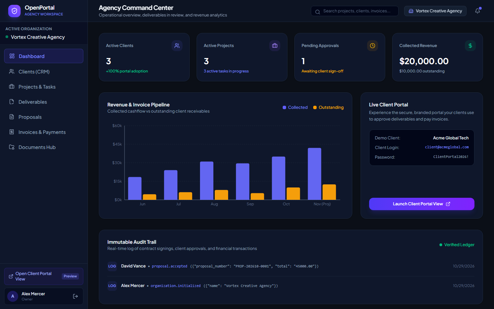
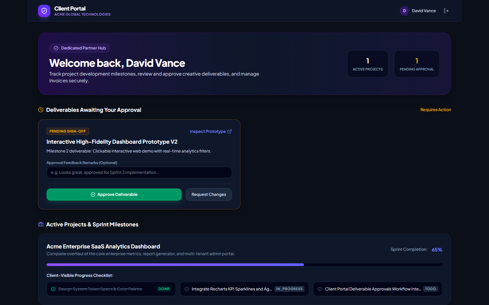
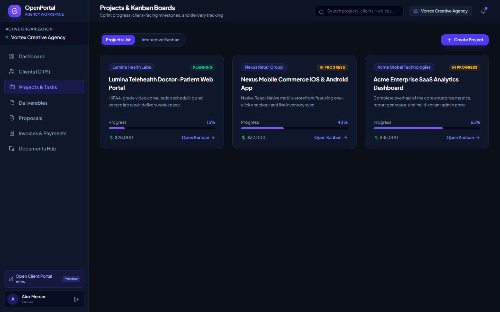
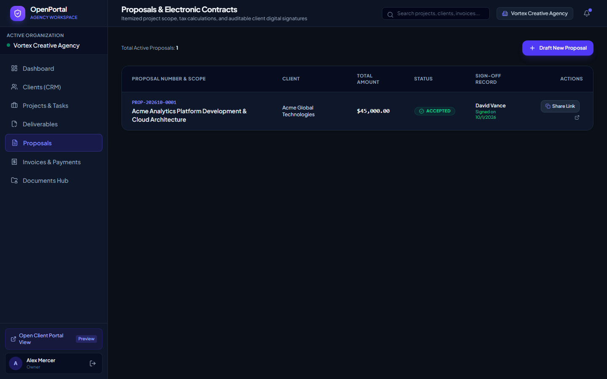
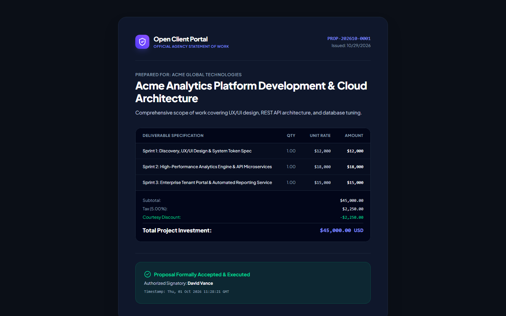
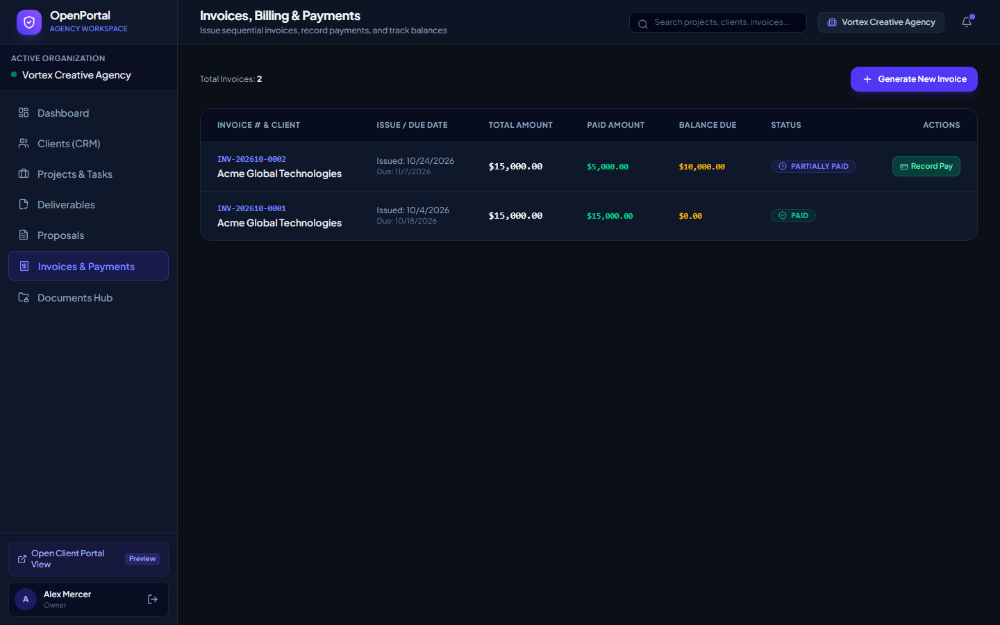
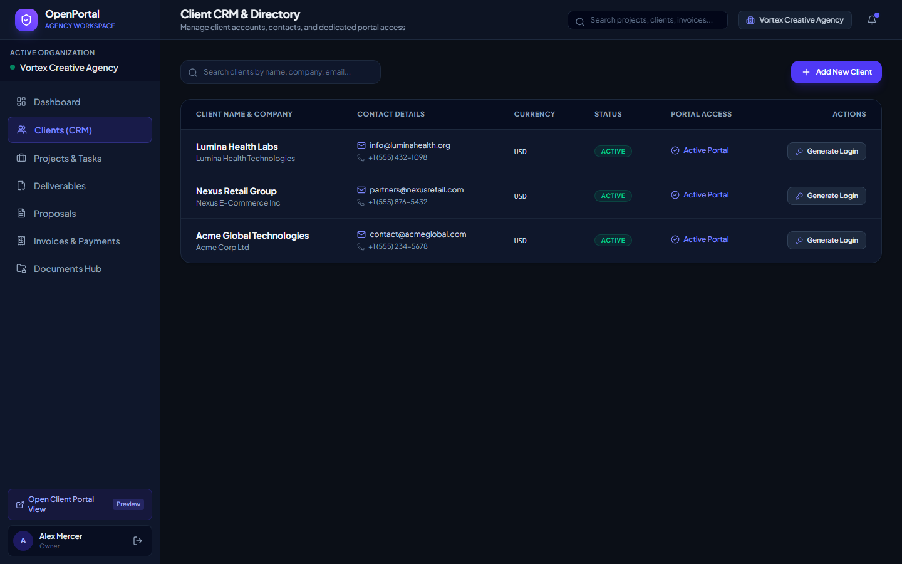
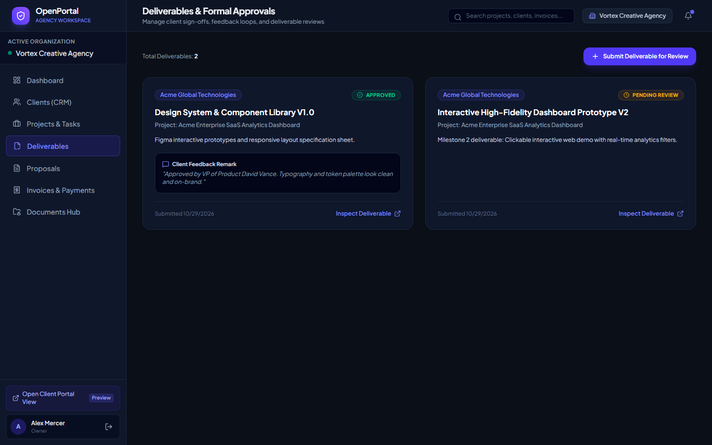
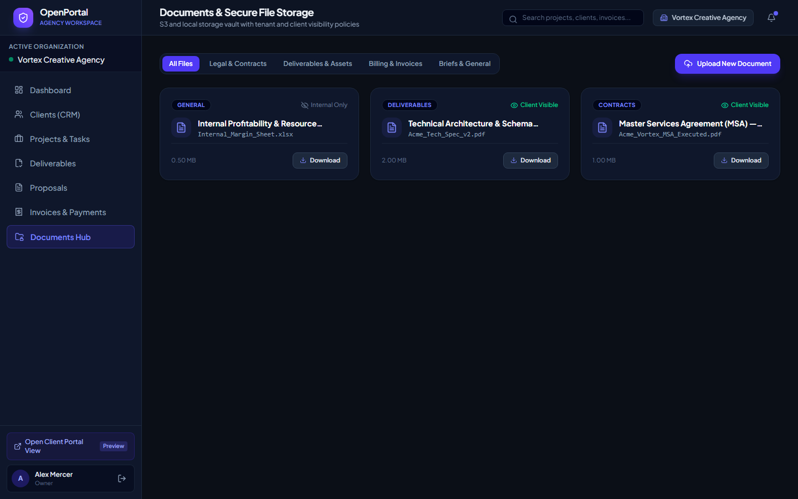

# Open Client Portal — Self-Hosted Client Workspace for Freelancers & Agencies

> **Your clients. Your projects. Your infrastructure.**

[](LICENSE)
[](https://fastapi.tiangolo.com/)
[](https://react.dev/)
[](https://tailwindcss.com/)
[](https://www.postgresql.org/)
[](apps/api/tests/)

**Open Client Portal** is a modern, privacy-first, open-source alternative to expensive proprietary client portal SaaS platforms (such as HoneyBook, Copilot, Clientjoy, and Bonsai). Designed specifically for freelancers, boutique software agencies, creative design studios, and consultants who value data sovereignty, clean UX, and zero mandatory subscription fees.

---

## 📸 Application Showcase

### Agency Command Center & Revenue Analytics
*Real-time cash flow metrics, active client count, pending deliverable approvals, and immutable audit logs.*


### Dedicated Branded Client Portal (`/portal`)
*Dedicated external client experience: review pending deliverables, track milestone progress, inspect invoices, and communicate feedback.*


### Interactive Projects & Kanban Task Boards
*Track sprint tasks across Todo, In Progress, In Review, and Done with granular client-visibility privacy controls.*


### Itemized Electronic Proposals & Scopes of Work
*Create transparent, scoped proposals with automatic tax calculations, discount arithmetic, and sequential numbering.*


### Client Proposal Review & Digital Signature Execution
*Public/client proposal review link with legally recorded digital signatures and execution timestamps.*


### Invoices, Billing & Payment Reconciliation
*Issue sequential invoices (`INV-YYYYMM-XXXX`), log partial payments, track balance due, and reconcile cash flow.*


### Client CRM & Portal Credential Generation
*Manage individual and corporate client accounts, contacts, billing details, and generate instant 1-click portal credentials.*


### Deliverables & Client Formal Approval Workflow
*Formal client review loops: submit prototypes and design assets, receive client remarks, and track signed approvals.*


### Secure Documents & Privacy Vault
*Categorized file storage (Contracts, Deliverables, Invoices, Briefs) with server-enforced internal vs client access control.*


---

## 🚀 Key Features

- **Multi-Tenant Organization Isolation:** Strict tenant separation across all database queries, preventing unauthorized cross-company visibility.
- **Client CRM & Contact Directory:** Manage individual and enterprise clients, multiple contacts, billing addresses, and tax identifiers.
- **Instant Client Portal Onboarding:** 1-click portal credential generator allowing clients to log in immediately and inspect their projects.
- **Project Progress & Kanban Boards:** Interactive drag-and-click status transitions with clear visual distinction between client-visible tasks and private agency tickets.
- **Formal Deliverable Sign-Offs:** Clients can formally approve or request changes on submitted assets with audit trail timestamps and feedback notes.
- **Itemized Proposals & Digital Signatures:** Scoped proposals with automated decimal arithmetic, public token links, and digital signature capture.
- **Sequential Invoicing & Reconciliation:** Concurrency-safe invoice numbering (`INV-YYYYMM-XXXX`), partial payments, and overdue tracking.
- **Encrypted Local & S3 File Storage:** Secure file management with server-side validation against unauthorized client downloads.
- **Immutable Audit Trail:** Append-only transaction and action logging capturing every contract acceptance, deliverable approval, and payment.
- **One-Command Docker Deployment:** Complete production stack with PostgreSQL 16 and Nginx edge proxy.

---

## ⚡ Quick Start with Docker

The fastest way to deploy Open Client Portal in production is using Docker Compose:

```bash
# 1. Clone repository
git clone https://github.com/0xyz-exe/open-client-portal.git
cd open-client-portal

# 2. Configure environment
cp .env.example .env

# 3. Start services
docker compose up -d --build

# 4. (Optional) Populate realistic demonstration data
docker compose exec api python seed.py
```

The portal is now running at `http://localhost/`!

---

## 🛠️ Local Development Setup

### Backend Engine (`apps/api`)
```bash
cd apps/api

# Create virtual environment & install dependencies
uv venv
uv pip install -e ".[dev]"

# Seed database with sample agency & clients
.venv/Scripts/python seed.py

# Run development server
.venv/Scripts/uvicorn app.main:app --reload --port 8000
```

### Frontend Application (`apps/web`)
```bash
cd apps/web

# Install packages
pnpm install

# Start Vite dev server
pnpm dev --port 5176
```

### Pre-Configured Demo Accounts
| Role | Email | Password | Interface |
| :--- | :--- | :--- | :--- |
| **Agency Owner** | `owner@vortexagency.io` | `AgencyOwner2026!` | `/app` (Agency Command Center) |
| **Client Portal** | `client@acmeglobal.com` | `ClientPortal2026!` | `/portal` (Branded Client Hub) |

---

## 🧪 Automated Testing & Verification

Open Client Portal includes unit, integration, and multi-tenant security isolation tests:

```bash
cd apps/api
.venv/Scripts/pytest -v
```

### Test Suite Coverage
- `tests/test_auth.py` — Registration, JWT login, organization creation.
- `tests/test_crm_projects.py` — Client CRUD, milestones, task kanban transitions, deliverable approvals.
- `tests/test_proposals_invoices.py` — Itemized math, digital signature recording, sequential invoices, payment balances.
- `tests/test_multi_tenant_security.py` — Tenant isolation, client portal data boundaries, internal comments/tasks privacy filtering.

---

## 🏛️ Technology Stack

| Component | Technology | Rationale |
| :--- | :--- | :--- |
| **Backend API** | [FastAPI](https://fastapi.tiangolo.com/) + Python 3.12+ | High concurrency, native async support, automatic OpenAPI schemas |
| **Database ORM** | [SQLAlchemy 2.0](https://www.sqlalchemy.org/) | Type-safe queries, migration support, supports PostgreSQL & SQLite |
| **Schemas** | [Pydantic v2](https://docs.pydantic.dev/) | Strict runtime data validation and serialization |
| **Frontend SPA** | [React 19](https://react.dev/) + [Vite](https://vitejs.dev/) | Fast build times, modern component model, modular SPA architecture |
| **Styling** | [Tailwind CSS v4](https://tailwindcss.com/) | Ultra-lean atomic utility CSS with dark-mode theme tokens |
| **Icons** | [Lucide React](https://lucide.dev/) | Clean, accessible iconography |
| **Data Viz** | [Recharts](https://recharts.org/) | Declarative SVG cash flow and project analytics |
| **Container** | [Docker Compose](https://www.docker.com/) | 1-command deployment with persistent volume storage |

---

## 📄 License

Open Client Portal is open-source software licensed under the [MIT License](LICENSE).
